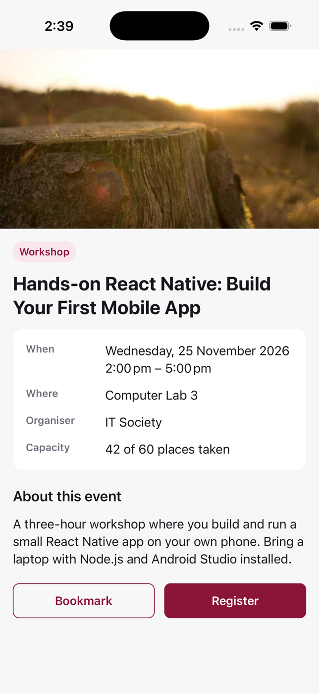

# S1 lab: build the Event Detail screen

Build `EventDetailScreen` so it matches the reference screenshot. Use only `View`, `Text`, `Image`, `Pressable` and `ScrollView`, styled with `StyleSheet` and the tokens in `src/theme`.



## What the screen shows (top to bottom)
1. Event image, full width, 16:9.
2. Category tag (reuse `Tag`).
3. Title (heading).
4. A card with label/value rows: **When** (date + time range), **Where**, **Organiser**, **Capacity** ("42 of 60 places taken").
5. "About this event" + description.
6. Two buttons side by side, equal width: **Bookmark** (outline) and **Register** (filled). Reuse `Button`. They don't do anything yet.

## Hints
- Render it by temporarily switching `src/app/App.tsx` to `<EventDetailScreen event={sampleEvents[0]} />`. There is no navigation until S2.
- Rows: `flexDirection: 'row'`, a fixed-width label, and `flex: 1` on the value so it wraps.
- Equal-width buttons: put both in a row and give each `flex: 1`.
- Keep content clear of the notch with `useSafeAreaInsets()`.
- Check dark mode: every colour must come from `useColors()`.

Solution: tag `s1-end`, `src/screens/EventDetailScreen.tsx`.

---

## Regenerating the reference screenshot (lecturer)

1. In `src/app/App.tsx`, temporarily render `<EventDetailScreen event={sampleEvents[0]} />` instead of `<HomeScreen />`. Don't commit this.
2. Run the app with the device in **light mode**. Wait until the image has loaded.
3. Capture at full resolution:
   ```sh
   # iOS simulator (booted)
   xcrun simctl io booted screenshot "$PWD/docs/labs/s1/event-detail-ios.png"

   # Android emulator: make sure FIT Events is the foreground app first
   adb exec-out screencap -p > docs/labs/s1/event-detail-android.png
   ```
   Or use the camera button in the emulator / simulator toolbar.
4. Shrink before committing (macOS): `sips -Z 1400 docs/labs/s1/*.png`.
5. Open the PNG and check it really shows FIT Events, then revert `App.tsx`.
